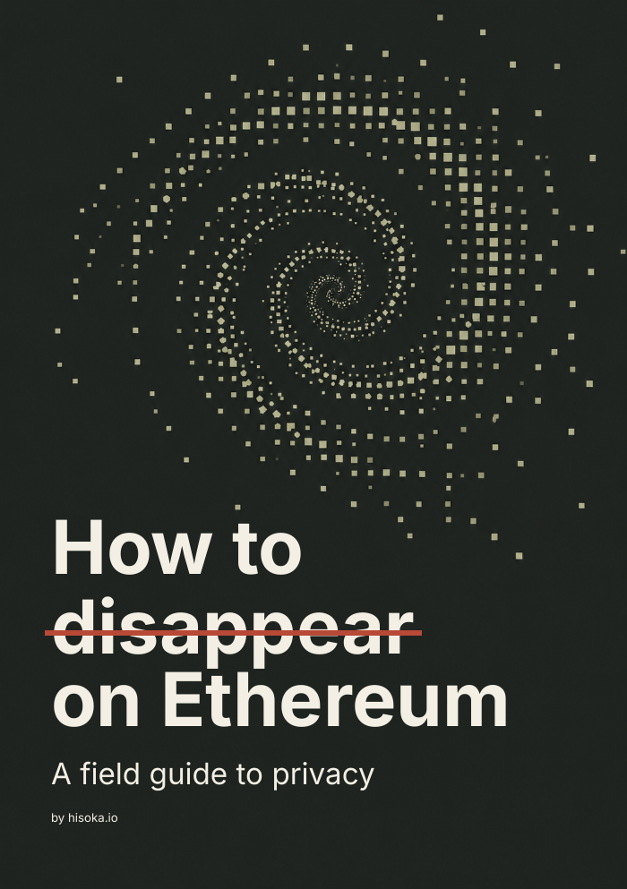

# How to disappear on Ethereum

<p align="center">
  
</p>

A short introduction to privacy on Ethereum and what different privacy approaches can protect.

The book will keep evolving. To suggest a change or add content, please open an issue or pull request.

## Build the PDF

With Pandoc and XeLaTeX installed, run:

```sh
./build.sh
```

For the print-ready PDF, install Ghostscript, qpdf, and `pdfinfo`, then run:

```sh
./build.sh print
```
